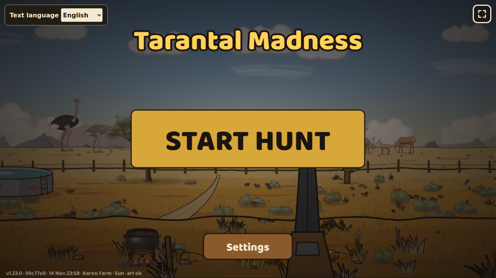
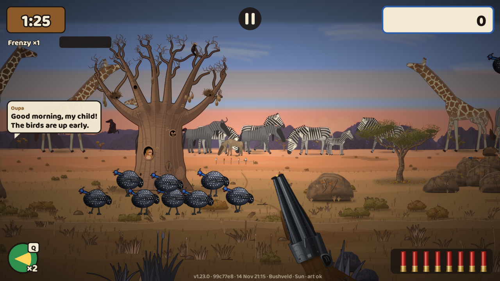
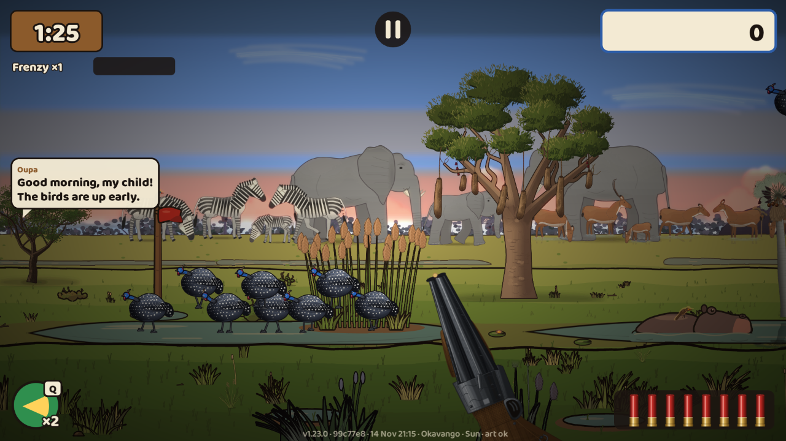
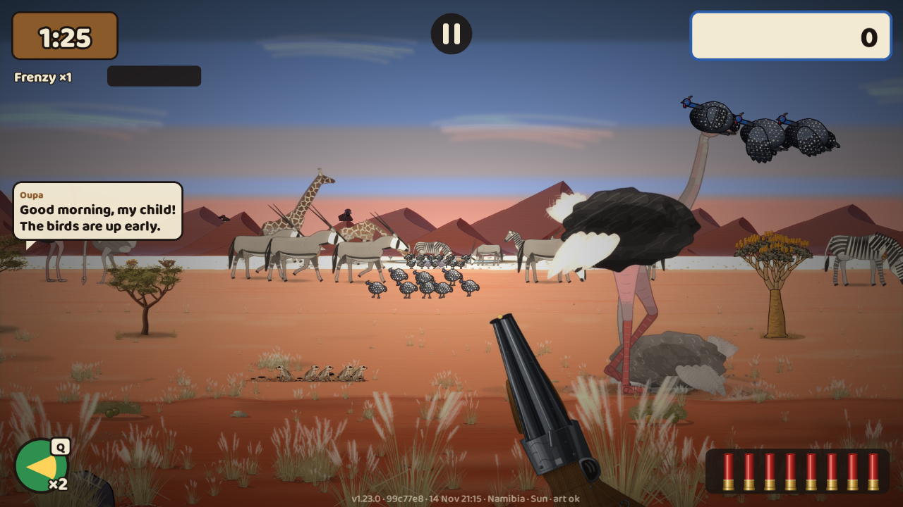
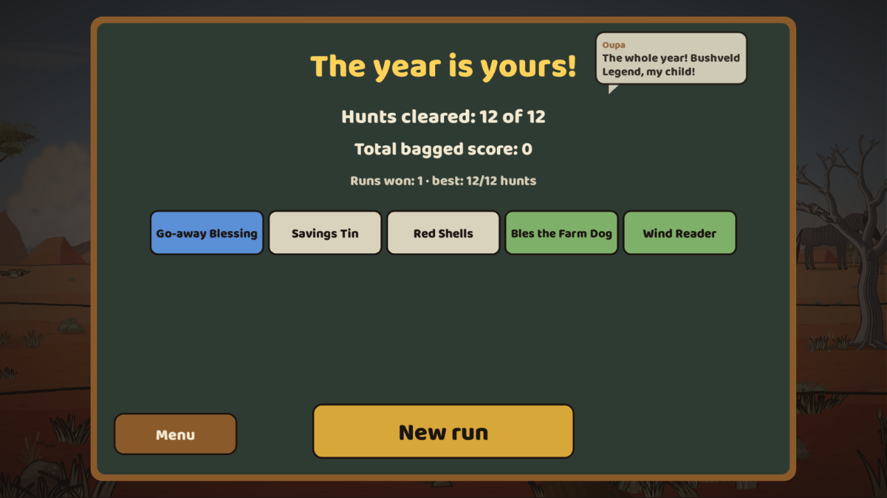
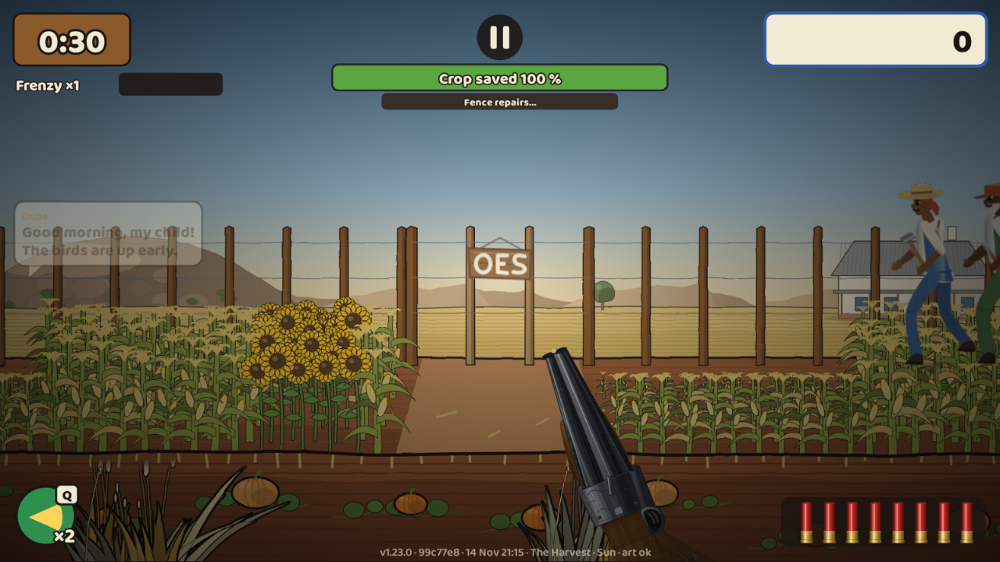
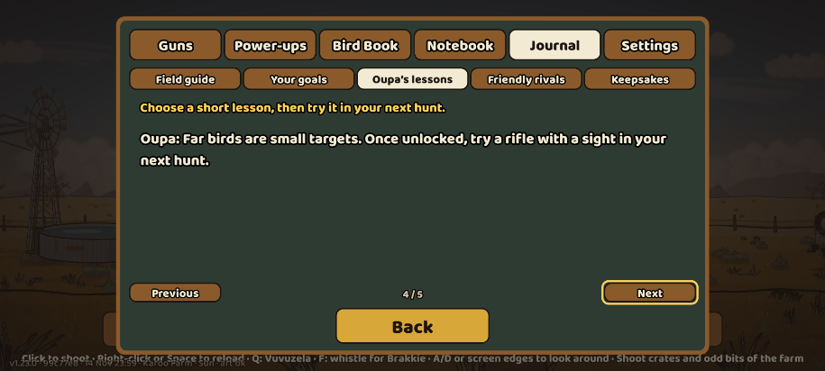
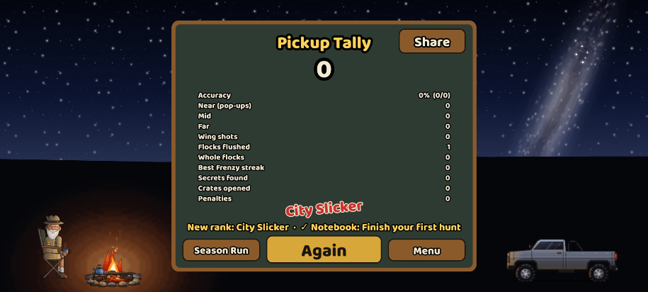
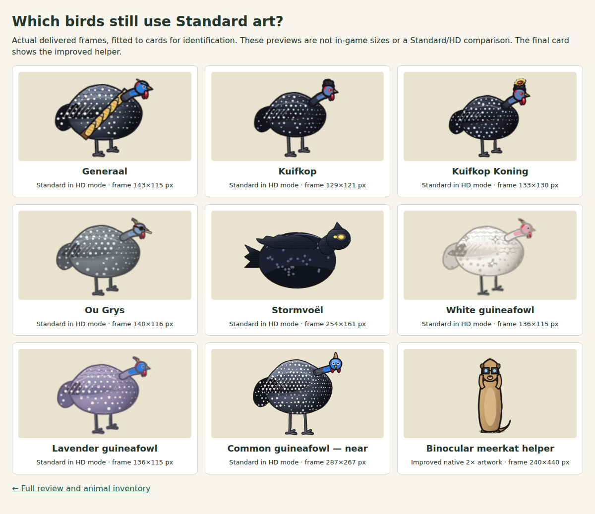

# Game flow and animal-art review — 14 November 2026

This is the earlier same-day implementation review. The expanded illustrated critical playtest,
with later Chromium and actual Linux WebKit evidence, is served through this task’s **Preview**.
The full local evidence remains in `docs/playtest-2026-11-14/` and is not included in this GitHub handoff.
The final findings below supersede the initial engine-availability limitation recorded in the earlier review.

## Changes made

First-time players can open Settings before Oupa's lesson. This makes sound and accessibility
available before shooting starts. Start Hunt remains the primary action, and the other modes
still unlock after the lesson. Opening and closing Settings preserves the tutorial route.

The binocular meerkat helper was still a 120 × 220 Standard-only sprite. It now has a freshly
rendered 240 × 440 source with directional fur, coat shading and binocular highlights. Both
graphics modes use that source. Display scaling and burrow cropping preserve its existing
screen size. The delivered PNG grows from 4,247 to 12,268 bytes; uncompressed texture memory
grows by 316,800 bytes (about 0.30 MiB). Simulation rules, animal sizes and hitboxes do not change.

Dusk screenshots exposed hard horizontal lighting bands in the sky. Bounded sky haze now
feathers across its outer quarters using 32 batchable strips, without adding textures. Whole-sky
haze and ground mist retain their original behaviour. The bird-contrast audit samples the same
opacity profile as the renderer.

A new `npm run assets:animals` command checks animal image dimensions and inventories HD
coverage. The full table is in [ANIMAL-ART-AUDIT.md](../ANIMAL-ART-AUDIT.md). Regenerate it with:

```sh
npm run assets:animals -- --out docs/ANIMAL-ART-AUDIT.md
```

## Which animals still lack separate HD artwork?

- Rare/boss bird atlases: Generaal, Kuifkop, Kuifkop Koning, Ou Grys, Stormvoël, white and
  lavender guineafowl. The ordinary guineafowl's near-plane atlas also remains Standard.
- Distant herds: elephants, giraffes, wildebeest, zebras, springbok, ostriches, gemsbok and
  lechwe, including the mixed waterhole herd.
- Harvest phase 2: the shared sheet containing its warthogs, piglets and baboon artwork.

These are explicit exclusions in the existing mobile texture-budget policy. Enabling every
large atlas would exceed the game's 256 MiB target on some maps. They were not silently
upscaled or relabelled HD. Desert meerkats and the dassie scene already use native high-resolution
textures in both modes; the weaver sheet contains higher-resolution bird drawings. Brakkie,
cameos, baboons, baobab residents, tell animals, mid-plane ostriches and the original Harvest
sheet have HD twins. Hippos, lily frogs and the separate weaver sprites also have HD twins;
Halloween bats and owls use a native 2× sheet.

All delivered artwork is still classified as interim by the project. Resolution coverage is
not a claim that every drawing is final or that further artistic improvements are impossible.

## Flow assessment

The intended sequence is coherent: first lesson → ordinary hunts and tally → area/weapon
progression, Daily or Harvest, and the twelve-hunt Season Run. Season Run alternates hunt cards,
hunts, tallies and shop decisions across four seasons, with saved progress between visits.
The first-launch Settings gate was an avoidable obstacle and is removed.

Browser run tests use shortened
hunts and, for the full Season Run, zero quotas to test transitions; they do not prove real-player
difficulty or completion rates. Phone emulation does not replace testing on physical phones.

## Balance sample

A competent bot played 100 runs with no charm-buying policy and 100 with synergy-focused
purchases, seeds 1–100, using the real twelve-hunt quotas. Seasonal pass rates are conditional
on reaching that season:

| Season | No charm policy | Synergy policy |
| --- | ---: | ---: |
| Autumn | 84.0% | 94.0% |
| Winter | 53.6% | 76.6% |
| Spring | 22.2% | 55.6% |
| Summer | 0.0% | 47.5% |

Nineteen of the 100 synergy runs completed all twelve hunts. Spring without charms and Summer
with synergy exceed the old target bands (10% and 35%, respectively); the other six checks fit.
This is not a blocked progression path. Quotas are unchanged: making the game harder solely to
match an old bot target would need stronger player evidence. The sample demonstrates the value
of shop choices, not a predicted human completion rate.


## Visual and asset validation

The animal audit covers 59 gameplay sheet/plane entries and found no unexplained resolution
or PNG-dimension gaps. The full asset audit passed with 677 keys: 676 interim assets and the
one expected procedural mirage placeholder. The strict download check passed at 2.94 MiB gzip
for first playable, against a 5 MiB budget.

HD screenshots were inspected for all five environments, including the newly softened dusk
lighting. No missing textures, failed asset requests or JavaScript errors appeared in this sweep.
The helper was also activated and inspected both in Karoo and at a Kalahari burrow.

| Environment | Sampled loaded texture memory |
| --- | ---: |
| Karoo | 192.0 MiB |
| Bushveld | 200.7 MiB |
| Okavango | 233.4 MiB |
| Kalahari | 200.0 MiB |
| Namibië | 198.1 MiB |

These samples were taken shortly after loading the late assets in an HD hunt. They are not
worst-case peaks or physical-phone performance measurements. They explain why adding large
HD bird atlases indiscriminately would be risky, particularly in Okavango.

The current cartoon style is consistent, but several distant herds are visibly simpler than the
foreground birds and cameos. A future art pass should improve anatomy, coat detail and shading
at their existing texture sizes before increasing resolution. All artwork remains labelled interim.

Desktop browser checks cover first launch and tutorial, Settings, keyboard navigation, pause,
resume and quit, graphics switching and download fallback, context-loss recovery, saved seasons,
Daily Hunt, Harvest, weapon reload behaviour, the journal, the power-up guide, language-picker
placement, and corrupt/unavailable storage. Phone checks cover first launch, tutorial, touch menus
and the Pixel landscape HUD. The iPhone profile used Chromium emulation; native Safari/WebKit
could not be validated on this host.


## Final verification

- `npm run check`: passed — 300 test files, 2,597 tests, clean type checking, ESLint and
  formatting, and all 57 content files valid with no warnings.
- `npm run build`: production build passed.
- `npm run size -- --strict`: final production build passed at 2.94 MiB gzip for first playable.
- Selected browser coverage: 36 checks passed across desktop and phone emulation, including
  the complete twelve-hunt Season Run and save/reload. Thirteen phone-profile exclusions were
  intentional skips. The first full-season attempt reached the last hunt's transition but hit
  its ten-minute test limit under concurrent load. A local rerun with the same assertions and
  a longer allowance completed in 9.2 minutes, verified victory, twelve completed hunts, a
  cleared active-run save and the recorded win.
- `npm run assets:animals`: 59 entries checked; no unexplained coverage/dimension gaps.
- `npm run assets:audit`: passed.
- All five HD environments and both helper placements rendered without asset or browser errors.

The full-run browser test uses short hunts and zero quotas; the separate balance sample above
uses real quotas. Screenshots were inspected, but committed visual-regression baselines were not
regenerated locally, following project policy. Native Safari and physical-device frame rates
remain unverified.

## Final overnight review — 15 November

The game has a coherent arcade loop and a distinctive setting. The inaccessible Journal advice and unclear Notebook completion marker are now corrected. The next clear improvement is to explain Harvest’s hidden bonus-round requirement, followed by a clearer next goal after the tutorial and more consistent animal-art finish. Reactive flocks, environmental discoveries and the Season Run’s hunt–shop rhythm are worth preserving. Physical-phone validation remains a release gate. The unchanged three-second startup test still fails on this host at 3.48 seconds after an isolated rerun; treat startup profiling and physical-device validation as the first remaining technical work.

Reviewed from the perspective of an impatient new arcade player: can I start quickly, identify what to shoot, understand my result, and see a reason to play again? This is an AI-assisted functional and visual review, not a recruited young-player study or a claim of human enjoyment.

Coverage: 145 map configurations passed; the 246-case desktop sweep recorded 219 initial passes, six initial failures and 21 exclusions. Five unsuccessful cases passed disclosed reruns; the unchanged startup criterion remains failed. The final code check passed 2,597 tests in 300 files. Actual Linux WebKit was exercised, but physical Safari/Android performance remains unverified. No tests were rerun for the GitHub handoff, including after merging main.

### F01 — Fixed: The previous report link returned 404

**Observed:** It used a filesystem path as a browser URL. The supplied screenshot shows HTTP 404, so the report was effectively inaccessible.

**Action:** Serve the illustrated document through tank Preview, with working relative links, downloadable evidence and a Play game button.

**Acceptance:** Preview opens the report; every local image and document link returns HTTP 200; Play game boots the production build.

### F02 — P1: Native iPhone and physical-phone performance still need evidence

**Observed:** Phone-profile checks now cover Chromium and actual Linux WebKit, using emulation and software rendering, so their frame timing cannot establish physical-phone performance. Ordinary HD hunts sampled 221–236 MiB. The stress cases reached 248.3 MiB in Harvest, leaving 7.7 MiB below the 256 MiB limit; the rain-to-braai transition passed at 238.2 MiB on a longer rerun. These are registered RGBA texture-size estimates, not total GPU/process memory or worst-case physical-device peaks.

**Action:** Make a device pass a release gate. Record OS/browser/device, peak texture memory, frame-time percentiles, input problems, reload behaviour and any context loss. Include Standard fallback.

**Acceptance:** No crash, lost progress, stuck controls or unreadable HUD during two consecutive runs per target device; confirm the project’s 256 MiB texture target and medium-tier 60 fps goal under representative load.

### F03 — P2: The tutorial-to-menu handoff exposes too many competing choices

**Observed:** The returning title adds an area picker, a daily-map label, an unlock quota and five bottom-row destinations. A long controls sentence runs along the bottom. There is no single highlighted next learning goal on this screen.

**Action:** Show one concise next goal after the lesson, such as completing a normal hunt or unlocking the first weapon. Keep other modes available. Move the full controls list into an accessible help panel and keep only the relevant short hint on the title.

**Acceptance:** In a five-person novice test, at least four can state their next goal without explanation. All current modes remain reachable and keyboard focus remains predictable.

### F04 — P2: Quality and Graphics describe different systems but sound interchangeable

**Observed:** “Quality” changes the performance tier, including render scale and effects, while “Graphics” selects Standard/HD asset files. Both appear on the same page. The Graphics helper explains a larger download, but selecting HD does not override a lower-resolution render tier. Explicit matched captures confirmed Medium scale 0.83 with vignette and High scale 1.0 with vignette plus bloom, both using HD assets.

**Action:** Use clearer labels such as “Performance tier” and “Artwork detail,” with a brief explanation that performance can reduce effects and render sharpness, while HD supplies more detailed asset files. Preserve the distinction in all four languages and state when a change takes effect.

**Acceptance:** A new player can identify the control for smoother play and the control for sharper artwork without trial and error; long translations fit at Large text size.

### F05 — P2: HD coverage is uneven and resolution does not equal finished artwork

**Observed:** Some assets have HD twins or native 2× masters; several rare-bird atlases, distant herds and Harvest phase 2 intentionally remain Standard. The herd drawings also have simpler shading and surface detail. All assets remain classified as interim in the project pipeline.

**Action:** First improve the most visible drawings at their current dimensions. Prioritize the commonly seen near bird and prominent herd silhouettes; inspect anatomy, feet placement, edge quality and shading at actual display size. Then repack trimmed atlases and evaluate selective HD upgrades against peak memory.

**Acceptance:** Approve an actual-size Standard/HD contact sheet for each affected animal and a full-scene comparison in all five areas. Preserve hitboxes and display size, with no texture-budget regression.

### F06 — P2: The first graphics decision offers no visual comparison

**Observed:** Before reaching the title, the player chooses Standard or HD. The card explains the download and recommends Standard, but it has no side-by-side visual example.

**Action:** Either start in Standard and offer HD after the first hunt, or add a small representative comparison and an immediate-play path. Keep the download size and remembered preference.

**Acceptance:** A fresh player can reach the lesson with no extra technical decision, or can understand the visual difference from the card itself. Slow/failed HD downloads must still fall back cleanly.

### F07 — Fixed: Coaching recommended an admin-only training range

**Observed:** Before correction, the lessons recommended the training range, but Skietbaan is admin-only and ordinary menus provided no route to it. The original screenshot and source inspection confirmed this navigation dead end.

**Action:** Corrected all five affected coaching strings in English, Afrikaans, Dutch and German to recommend the next ordinary hunt. Sighted-rifle advice now says “once unlocked.” A separate fresh build passed four-language phone-width captures with Large text and high contrast. A public practice mode remains an optional later addition.

**Acceptance:** Every destination named in ordinary coaching is reachable through ordinary menus without a URL flag. If practice is added later, leaving it must preserve scores, unlocks and the active Season Run.

### F08 — P3: Make the season ending teach one useful lesson for the next run

**Observed:** The victory screen clearly celebrates completion and shows the score, win count and equipped charms. It does not provide a per-season performance breakdown on that screen. The screenshot uses one-second hunts and zero quotas, so its zero score is intentional test data.

**Action:** Add a compact optional run recap: strongest season, weakest quota margin and one notable charm contribution where the game can measure it accurately. Avoid inventing causal claims about charms.

**Acceptance:** The main victory screen remains readable on phones; the optional recap uses recorded data and can be dismissed in one action.

### F09 — P2: Harvest’s bonus-round requirement is not explained before it is earned

**Observed:** The code adds the crop bonus, then starts Phase 2 only if the score is at least 1,850 and crop remains above zero. The title advertises “30 s to save the crop,” while the bonus-round text announces success after the condition has already been met. The inspected player-facing copy does not explain the threshold in advance.

**Action:** Show a compact bonus-round goal before play or on a non-qualifying Harvest tally: finish the rush with 1,850+ points, including the crop bonus, and some crop remaining. Keep the first attempt’s explanation short.

**Acceptance:** The goal is visible without reaching Phase 2 first, uses the content-configured threshold rather than a hardcoded number, and fits all languages and Large text. Test below, at and above the threshold, with both zero and positive remaining crop.

### F10 — Fixed: Completed Notebook goals lacked a completion marker

**Observed:** Before correction, a completed goal was announced as “Notebook: Finish your first hunt,” with no explicit completion mark. The original screenshot records this after arrival at the tally.

**Action:** Added a check-mark prefix to the completed-goal announcement in all four languages and the Afrikaans-name overrides, and updated the translation reference table. The four-language phone-width captures show the marked first-hunt goal alongside its higher-priority rank announcement, with Large text and high contrast.

**Acceptance:** A completed goal clearly reads as completed in every language, without overflowing the tally news area at Large text size.

### F11 — P1: Startup still exceeds the three-second target on this test host

**Observed:** Initial combined game time was 4,235.2 ms. The isolated rerun measured 3,482.3 ms: ready 3,310.8 ms, start response 162.1 ms, first-shot response 9.4 ms. The result is 482.3 ms (16.1%) above the existing 3,000 ms limit.

**Action:** Profile the initial readiness path on representative desktop and physical phones before optimizing. Separate download, decode/upload, scene construction and first render costs. Prioritize measured blocking work; preserve asset completeness and avoid hiding the miss by increasing the threshold.

**Acceptance:** The unchanged desktop ≤3,000 ms criterion passes on the designated reference runner, with timings retained, and physical-phone cold/warm startup checks show no missing art, stuck input or lost preferences.

## Recommended sequence

1. **Make evidence accessible:** Keep this report, its pictures, the HD inventory and the game reachable through Preview. Verify links after every report update.
2. **Profile the remaining startup miss:** Five of the six unsuccessful desktop cases passed their disclosed reruns. The startup target still fails at 3.48 seconds; profile initial readiness on the reference runner before graphics expansion.
3. **Close real-device release gaps:** Run native Safari and Android stress sessions, then address crashes, input faults or budget violations.
4. **Repair guidance and clarify the next action:** The admin-only range advice and Notebook completion marker are corrected. Next explain Harvest’s bonus goal, then improve the tutorial handoff, controls hint and performance/art labels.
5. **Polish visible animals and depth:** Improve drawing quality at current sizes, compare full scenes, then selectively upgrade resolution within the memory budget.
6. **Reduce startup friction:** Test a simpler Standard-first flow or an informative HD comparison card.
7. **Add learning and replay value:** After the core is clear and stable, consider a player-facing practice mode and an optional season recap. The broken range recommendation should already be corrected in step 4.

## Selected screenshot evidence

Screenshots are unchanged copies from the completed review. HD captures do not establish physical-device performance. Full-run ending evidence uses shortened hunts and zero quotas to check transitions, not player difficulty.



Fresh production title.



Bushveld: HD assets at High render tier; detailed target birds and flatter distant herds.



Okavango: High render tier still exposes the simple elephant drawings.



Namibië: target/protected-animal recognition needs novice testing.



Twelve-hunt Season Run ending, using shortened hunts and zero quotas.



Harvest introduction; explain the 1,850-point and surviving-crop bonus-round requirement.



Corrected English Journal advice.



Corrected Notebook completion marker.



Animal-role identification examples, not an actual-size HD comparison.

## Handoff exclusions

Only the nine screenshots linked above are included here. No resizing was needed. All other review captures, generated `docs/art-preview/compare` updates, raw browser evidence, traces, HTML report tooling and PDFs remain local. The full PDF is `docs/playtest-2026-11-14/full-review.pdf` (35,324,458 bytes); its 178 pages include 201 image placements.
