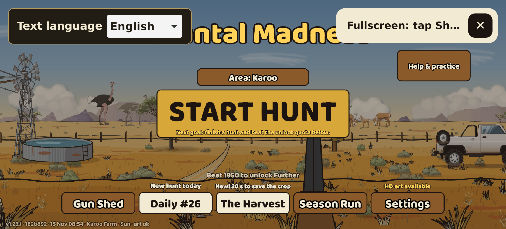
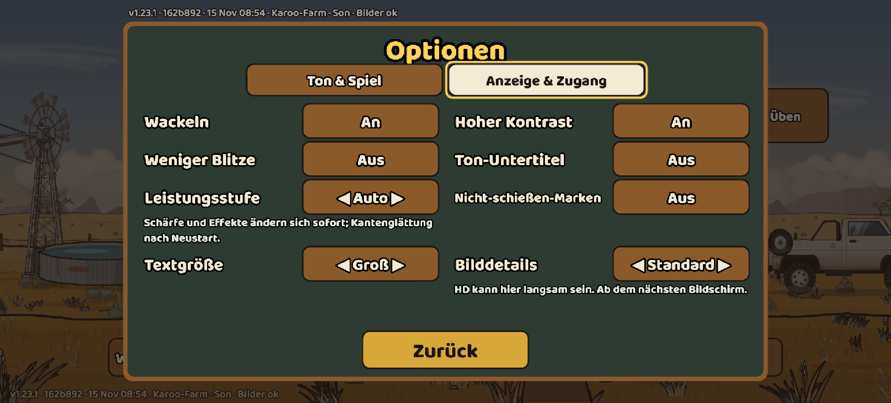
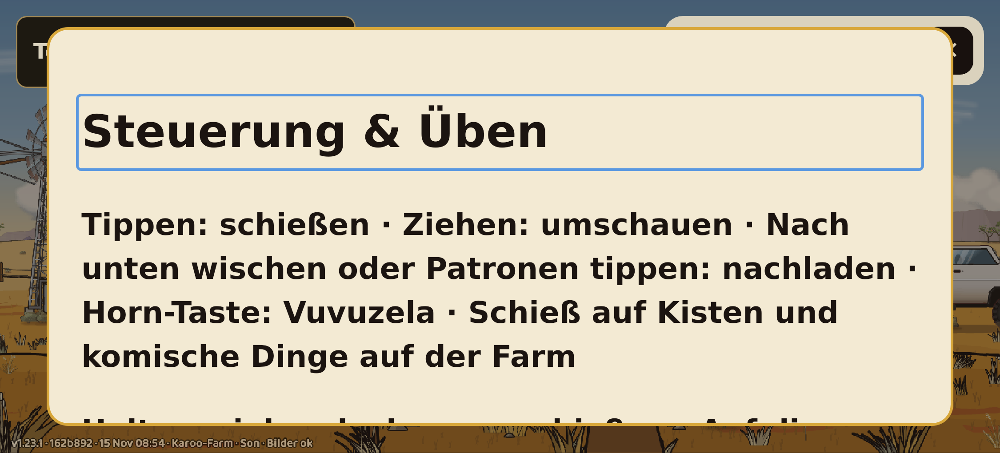
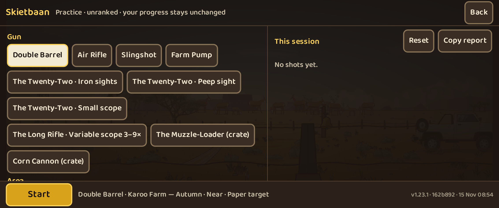
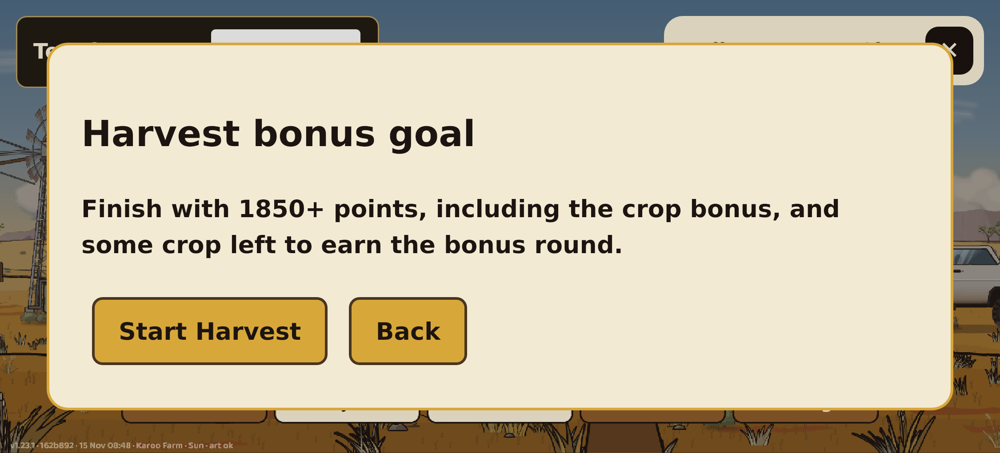
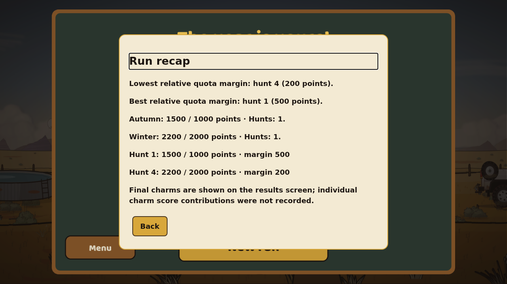
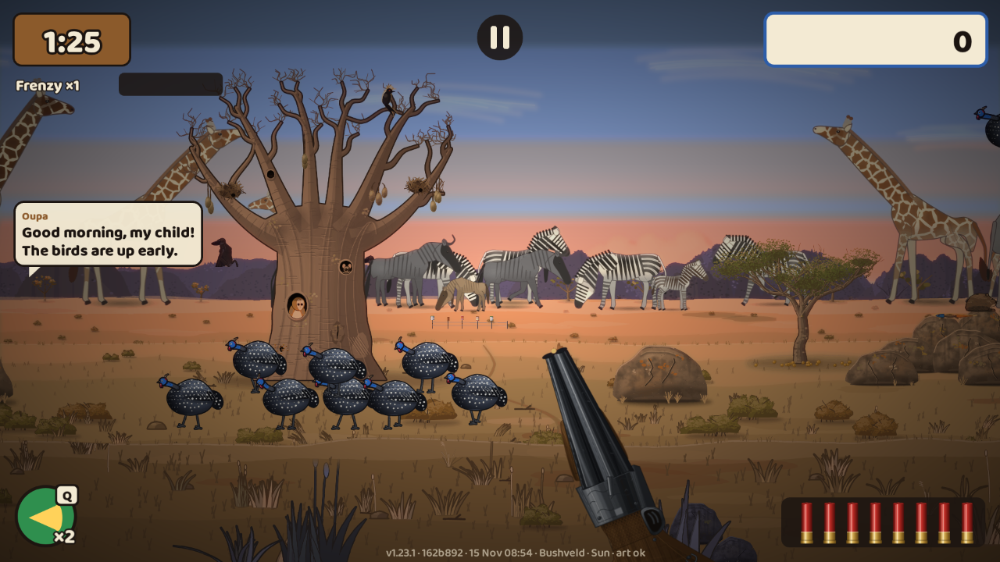
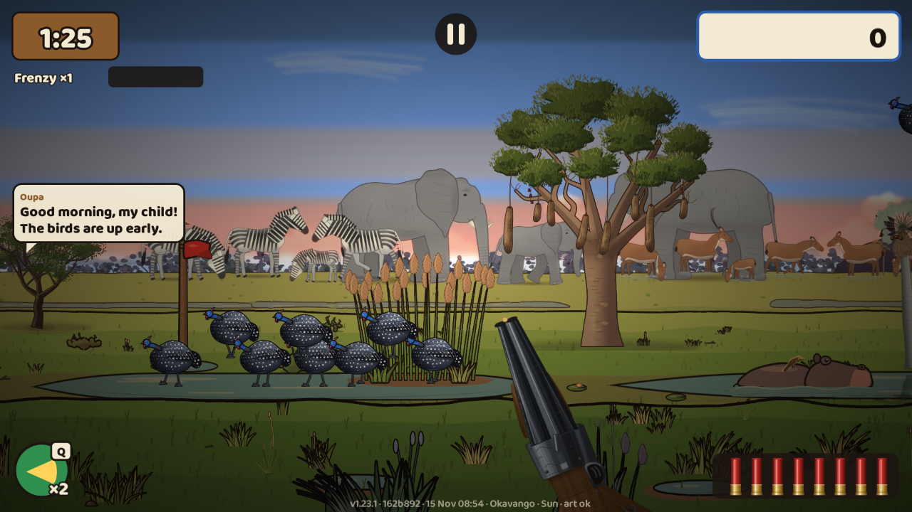
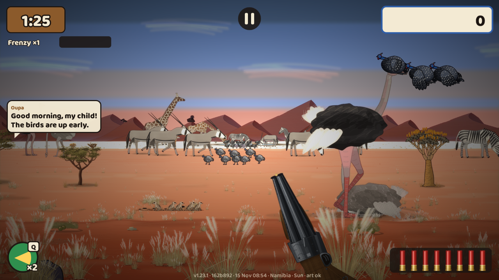

# Critical review follow-through — 15 November 2026

This is the implementation follow-up to the [14 November review](../review-2026-11-14/GAME-REVIEW-2026-11-14.md).
The historical 178-page PDF remains a record of that review, not proof of the new build.
Changes are on `v122-review-improvements`, based on the PR #136 handoff.

## Changes in priority order

1. **Startup:** fonts begin beside the index request; the first hunt's baboon sheet begins beside core artwork. The unchanged desktop startup test passed at **2,612.5 ms**, comprising readiness 2,424.1 ms, Start response 175.6 ms and shot response 12.8 ms. No baboon-sheet or simulation-chunk wait occurred. This is one isolated sandbox measurement; physical-device timings remain required.
2. **Physical phones:** the release checklist remains open. No physical iPhone or Android device was available. Desktop Chromium, Android-sized Chromium and iPhone-sized Linux WebKit checks do not certify Safari, device thermals, GPU memory pressure or sustained frame rate.
3. **Harvest goal:** a pre-start panel states the bonus-round threshold from content (currently 1,850), includes the crop bonus, and requires surviving crop. Back cancels; Start Harvest begins the existing game.
4. **Next action:** returning players see the next-goal reminder inside Start Hunt, beside the existing unlock quota. Once bonus maps are unlocked, the reminder points to those maps or improving the best score.
5. **Controls:** Help & practice replaces the long bottom hint. Its panel explains the relevant input controls and scrolls from its heading. The button is below the iPhone installation banner, which otherwise intercepted taps.
6. **Settings:** Performance tier and Artwork detail now have distinct explanations in English, Afrikaans, German and Dutch. Large text reserves space according to the wrapped explanation's actual height.
7. **Animal artwork:** birds have revised body shading, distant herds have stronger anatomical lighting, elephant folds are less regular, and Harvest warthogs/piglets have finer fur detail. The fauna palette preserves gradients. Every delivered width and height remains unchanged; no blanket upscaling was added. Art remains interim.
8. **First launch:** fresh players begin in Standard without an art decision. Settings still offers HD; after the first hunt, the title points out that it is available. Existing remembered HD preferences and explicit comparison-card requests remain supported.
9. **Practice:** players can open the shooting range through Help & practice, try weapons, and return without changing progression. Available areas follow their unlocks. Admin reset controls remain hidden from public players; practice stays a lazy download.
10. **Run recap:** results can show recorded hunt scores, quotas, margins, seasonal totals and best/weakest relative quota margins. The panel explicitly says that individual charm contributions were not recorded. It does not invent attribution.

## Verification

- `npm run check`: passed. TypeScript, ESLint, formatting, 303 unit-test files / 2,632 tests, and 57 content files (zero errors or warnings).
- Desktop startup: unchanged 3,000 ms criterion passed at 2,612.5 ms; measured without concurrent browser or code-check jobs.
- Harvest Phase 2: both existing browser regressions passed on the Pixel 7 landscape profile, including the countdown, ending/tally and visible Phase 2 animation.
- HD texture-memory regressions: Okavango 240.4 MiB and Harvest 248.3 MiB, each below the unchanged 256 MiB limit. These are estimated texture allocations sampled by the existing browser tests, not a physical-device RAM measurement.
- Asset contract: all 525 width/height fields in Standard and HD indices match the branch base. The regenerated art files are individually below 2 MB. The refreshed [animal inventory](ANIMAL-ART-AUDIT.md) reports 59 entries and no unexplained resolution gaps.

- Player flows: all 15 combinations of fresh start, public practice, Harvest introduction, recap and accessibility settings across desktop Chromium, Pixel 7 landscape Chromium and iPhone 14 landscape WebKit passed across the recorded runs. Fresh-start checks also verify that Standard is persisted, not merely forced by the test harness.
- Additional languages: all six Large-text Help/Settings combinations (Afrikaans, German and Dutch on both phone profiles) passed. WebKit exposed two test synchronization gaps; the tests now await the Settings page and display tab before inspecting them. Those failed cases were rerun successfully. This is a consolidated result, not a claim that every earlier batch passed.
- Full scenes: Bushveld, Okavango and Namibië at High rendering tier with HD enabled passed asset/error checks and were visually inspected. The desktop captures used a fixed seed, Saturday layout and tick 300.
- Preview: the review, both PDF links, follow-up, current animal inventory, game entry and nine evidence images all return HTTP 200 (18 paths checked).

- Production Vite build: passed. The strict size check passed at **2.94 MiB gzip** for the initial download (3,087,749 bytes), below the 5 MiB budget.
- Clean production profile through Preview: the report and inventory links open, the game loads without test hooks, Standard is saved without a graphics-choice card, and no page errors occur.

The [verification data](verification.json) preserves measurements and batch totals, including the corrected failures. The nine linked screenshots total 4,065,198 bytes; each is below 2 MB. No PDF was regenerated: the original remains the historical review. Changes are local on `v122-review-improvements`; this follow-up has not been committed or pushed.

The implementation checks caught and corrected two Harvest frame-boundary regressions caused by
shared random-number consumption, overlapping Large-text settings hints, phone dialogs initially
scrolling to their final button, and the iPhone installation banner covering Help & practice.
No existing performance limit or visual baseline was relaxed.

## Remaining release work

Use the physical-device checklist appended to the original review. Record actual models, OS and
browser versions; Standard/HD cold and warm starts; normal and stressed frame times; touch, scope,
rotation and resume; Harvest Phase 2; Okavango rain and braai; memory-pressure fallback; and save
persistence. A human art review and novice playtest are still valuable; higher resolution alone
would not resolve all recognition or drawing-quality issues.

## Screenshot evidence

Returning-player title: Help & practice below the installation banner, next goal and HD offer. iPhone-sized WebKit; not a physical iPhone.

German, Large text and high contrast: separate performance/art explanations with no vertical overlap.

German Help opens at its heading; the panel scrolls to the actions.

Public practice setup: normal Back label and no admin Fresh load control. The setup list scrolls independently.

Harvest explains the threshold and surviving-crop condition before starting.

Recap UI exercised using a seeded two-hunt completed-run fixture; this image is not evidence of a new full twelve-hunt playthrough.

bushveld-winter: HD artwork at High rendering tier, held at tick 300 for visual inspection. Existing texture dimensions retained.

okavango-spring: HD artwork at High rendering tier, held at tick 300 for visual inspection. Existing texture dimensions retained.

namibie: HD artwork at High rendering tier, held at tick 300 for visual inspection. Existing texture dimensions retained.

